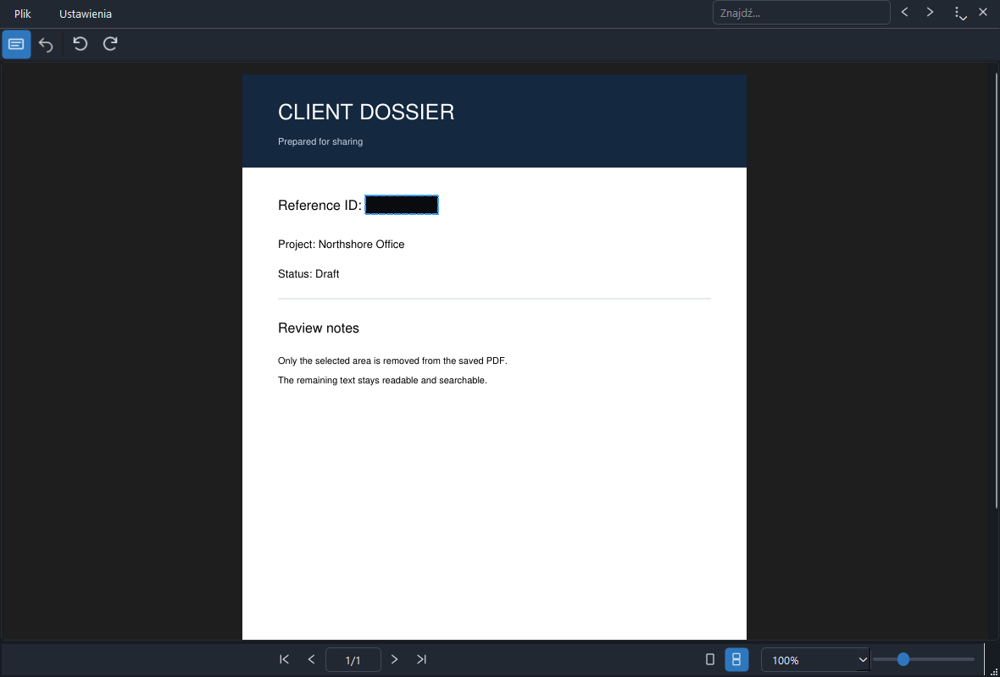

# BlurOut PDF

BlurOut PDF is a small, offline Windows PDF reader focused on drawing rectangular redactions and saving a shareable copy.



## Current features

- Open regular and password-protected PDFs; scroll through pages continuously or use single-page mode.
- Draw an area with the left mouse button while **Redact** is active. The selection is pending until saved.
- Undo the last pending redaction with Ctrl+Z.
- Save or Save as a fully rewritten PDF. Text intersecting the area is removed with PyMuPDF redactions; overlapping image pixels and vector content are removed. On a redaction save, the exporter also strips common hidden data, including metadata, embedded files, JavaScript, links and form responses.
- Choose black, fine-grain or coarse-grain covering. Grain is generated independently of the original content; it is not a blur of private pixels.
- Rotate pages, search text, navigate pages, and control zoom from the percentage box and slider.
- Search scanned pages with OCR when Tesseract language data is available. **Settings > OCR language** defaults to the Windows UI language plus English; it lists available models for manual selection and shows a warning when the chosen model is missing. Text already embedded in a PDF remains searchable without OCR.
- Polish on Polish systems; English elsewhere. Language can be changed in Settings. The UI follows the operating system's light/dark theme, including changes while the app is open.

OCR language models are not included in the installer yet. The app looks for `eng.traineddata` next to its code, in `TESSDATA_PREFIX`, or in supported Windows Tesseract data locations. Other languages need their matching `.traineddata` files in the same directory. The app does not download models automatically.

## Run from source

Requires Python 3.11+ on Windows.

```powershell
uv venv .venv
$env:UV_CACHE_DIR = "$PWD\.uv-cache"
uv pip install --python .venv\Scripts\python.exe -e ".[dev]"
.venv\Scripts\python.exe run.py
```

Open a file directly with `.venv\Scripts\python.exe run.py C:\path\to\file.pdf`.

## Verify

```powershell
.venv\Scripts\python.exe -m pytest -q --basetemp=.pytest-temp
```

The tests reopen saved PDFs and confirm that redacted text and common hidden data are gone. They also check rotation and the main window flow.

## Build a Windows installer

Install [Inno Setup](https://jrsoftware.org/isinfo.php), then run:

```powershell
.\packaging\build.ps1
```

This produces `dist\BlurOutPDF-Setup-0.1.0.exe`. The installer registers BlurOut PDF as an **Open with** option for `.pdf` files without taking over the default PDF viewer. The executable, installer and application window use the transparent icon derived from the supplied draft.

## Privacy and security scope

BlurOut PDF works locally and makes a fresh PDF when saving. The old source file is overwritten only if you choose **Save**; **Save as** creates another file. The exporter removes objects referenced solely by the redacted area and verifies that no extractable characters intersect each selected rectangle in the output.

PDFs can contain duplicate sensitive data elsewhere, including visible text on another page. Complex interactive PDF features and malformed PDFs need further validation before relying on the result for high-stakes disclosure. Review the saved file, especially all pages and any repeated information, before sending it. The current exporter removes links, embedded files, metadata and form responses when saving redactions. See [technical specification](docs/SPEC.md) for boundaries and planned work.

## License

The application is released under [AGPL-3.0-only](LICENSE). It uses [PyMuPDF](https://pymupdf.readthedocs.io/) (AGPL/commercial dual license) and [PySide6](https://doc.qt.io/qtforpython-6/) (LGPL/GPL/commercial). Review dependency notices before publishing binaries.
